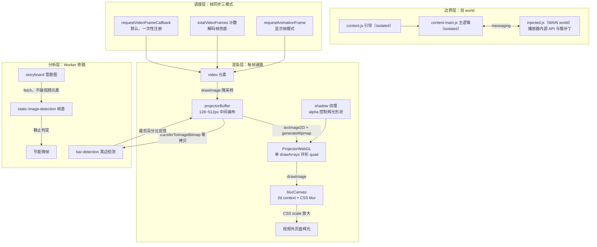

#### 实时视频辉光的五层管线架构

Ambilight（环境光）类应用把视频帧实时采样、放大、扩散到视频区域外的页面上，模拟飞利浦流光溢彩。
它不是视频滤镜（滤镜改视频自身像素，它作用于视频外的 DOM 空间），也不是一圈静态 CSS 辉光
（YouTube 自带 ambient mode 那种零 JS 方案），而是逐帧 GPU 管线。以 youtube-ambilight 扩展
（v2.38，MV3，零运行时依赖）为解剖样本，工程上可切五层：

- 边界层：三层注入双 world。isolated world 的引导脚本与主逻辑，加上 MAIN world 的注入脚本
  （唯一能碰播放器内部 API 的位置，HDR 状态、storyboard 格式、VR 帧时序都靠猴补丁取得），
  两个 world 间用自定义 messaging 双向通信
- 调度层：帧同步决定「什么时候重绘」，三种模式（视频帧回调、解码帧计数、显示帧）加节能降帧
- 渲染层：视频帧到辉光的 GPU 通路，降采样、mipmap、单次 drawArrays、CSS blur 放大
- 分析层：旁路像素分析下放 Worker（黑边检测、静止画面判定），不占主线程帧预算
- 对抗层：宿主（浏览器实现差异、YouTube 改版、DRM、CSP）持续搞破坏，workaround 家族兜底

见：[youtube-ambilight 源码](https://github.com/WesselKroos/youtube-ambilight)：src/scripts/libs 为核心，ambientlight.js 是调度中枢

#### 帧同步三模式与 GPU 渲染通路

帧同步（frameSync）的三个可选源：视频帧回调（requestVideoFrameCallback，rVFC，新帧呈现到
合成器才触发，最省）；解码帧计数（rAF 轮询 getVideoPlaybackQuality().totalVideoFrames 对比，
rVFC 不可用时的兜底）；显示帧（rAF 每帧都画，帧混合等时间域滤波必须用）。rVFC 是一次性注册，
回调里第一件事是重新注册下一个（preschedule），否则显示器帧率与视频帧率恰好相等时（60Hz 屏放
60fps 片）会稳定跳帧。rVFC 还有独立失效面：视频滚出视口后停火、后台标签页按规范停火，所以正式
管线必须并行维护帧计数对比做 fallback，离屏时退到 setTimeout 按视频帧率轮询。节能模式在画面
近乎静止时把重绘降到 1fps 甚至 5 秒一帧。

渲染通路每一环都有明确的量级取舍：video 先 drawImage 降采样到 projectorBuffer（尺寸按 blur
强度选 128/192/256，黑边检测开着则固定 256，上限 1024），再 texImage2D 上传 WebGL 纹理并
generateMipmap（video 源不走 texSubImage2D 增量更新，该路径对 video 源走 CPU readback，
反而比全量上传慢一个数量级）。辉光的「多层扩散」不画多张图：一次 drawArrays 画 24 顶点的环形
quad，片元着色器从 UV 反推该像素属于第几层缩放环，对同一纹理按环层缩放采样，层数由
round(spread/edge)+3 决定。模糊不在 shader 里做：结果 drawImage 到 2d context 的 blurCanvas
借 CSS filter blur（blur 强度大于 1 时半分辨率渲染白赚性能），最后 CSS scale 放大到扩散尺寸。
辉光的空间形状由独立的 shadow 纹理控制：512×512 渐隐图按幂曲线 keyframes 生成，shader 里用
它的 alpha 通道决定哪里亮哪里暗，支持四方向开关。帧淡化（frameFading）把多张历史帧纹理按平方
缓动透明度叠加做时间域低通；片元着色器纹理单元有硬上限（规范只保证 8 个），历史帧超出时用子
纹理图集破解：多帧写进同一张大纹理的不同子格（2×2 或 3×3），shader 里按 UV 偏移采样同一单元。
WebGL 全挂时还有 2D 兜底路径：N 个 canvas 元素叠放，各画同一帧、CSS scale 逐层放大加 blur，
靠合成器混合出近似效果。

见：[youtube-ambilight 源码](https://github.com/WesselKroos/youtube-ambilight)：ambientlight.js 调度、projector-webgl.js 渲染、canvas-webgl.js 纹理上传

#### 黑边检测与静止画面分析

黑边（letterbox bar）检测的完整算法链：512×512 降采样帧经 transferToImageBitmap 零拷贝传给
Worker；参考色用四条边的 116 个采样点做迭代修剪均值（按与当前均值的色差排序，逐轮剔除最远的
一半，收敛到 25% 存活，抗字幕和台标污染）；5 条扫描线从上下两个方向步进扫描，步长 4 粗扫，
遇到颜色偏离参考色就减半回退精扫，候选边界点在邻域网格上打 certainty 分（偏差容忍按参考色
亮度分黑/暗/亮三档阈值，得分经 easeInOutQuad 压缩）。单帧结果不可信，靠多帧历史众数投票
（0.5% 分组）防抖、参考色突变即清历史、检测到边后按耗时自适应节流（下一轮延迟 = 耗时^1.2 次方
减 250ms，5 秒封顶）。静止画面判定则完全不碰视频元素：拉 YouTube storyboard 预览雪碧图，
取第 2 页、中间页、倒数第 2 页的缩略图逐张算亮度加权帧差（BT.709 系数 0.2126/0.7152/0.0722，
0.03 死区），得出该视频的画面变化烈度，喂给节能降帧。

见：[youtube-ambilight 源码](https://github.com/WesselKroos/youtube-ambilight)：bar-detection.js 与 static-image-detection.js，算法都在 Worker 内联代码里

#### 宿主对抗：workaround 家族与降级链

在真实宿主里跑实时管线，一半代码在对抗环境。浏览器层：rVFC 在视频离屏后虚报 dropped frames
会连累 YouTube 降画质，只能在 MAIN world 猴补丁 getVideoPlaybackQuality 给离屏前后 2 秒的
计数打豁免修正；drawImage 会随机关掉抗锯齿（改用 clearRect 强制刷新）；窗口外的 blur 不渲染
（补 1px 占位 canvas）；Windows 的 direct video overlay 伪影、Firefox 的 readPixels 慢与外层
blur 不刷新（每 10 帧 translateZ 抖一下强制重绘），各带 bug 编号各打各的补丁。资源层：WebGL
context lost/restored 有完整生命周期管理，恢复 3 次失败即熔断防无限循环；创建 context 时先开
failIfMajorPerformanceCaveat 探测，软渲染设备自动把分辨率降到 25%。内容层：HDR 靠
new VideoFrame(video).colorSpace.primaries === 'bt2020' 检测，命中就切独立的非 WebGL 缓冲；
DRM（encrypted 事件）直接放弃并提示；跨域视频设 crossOrigin 后重载。基建层：Blob URL Worker
会被页面 CSP 静默拦截且 onerror 不一定触发，所以创建后立刻 postMessage 握手、5 秒无回执判失败，
降级为绑定主线程伪 scope 的 FallbackWorker（接口与真 Worker 一致，调用方无感知）。YouTube
SPA 导航则靠 MutationObserver 监视 video 元素脱离 DOM，自动重挂新元素。

见：[youtube-ambilight 源码](https://github.com/WesselKroos/youtube-ambilight)：ambientlight.js 的 detect*Workaround 家族与 worker.js 的降级链
